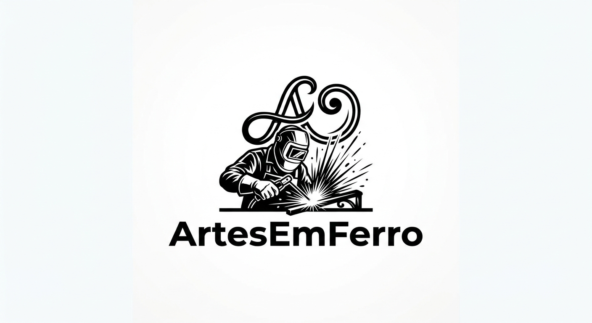

<div align="center">
  
  <h1>ArtesEmFerro</h1>
  <p><strong>Serralheria Artística · Peças Sob Medida · Ferro &amp; Aço</strong></p>
  <p>Site institucional e catálogo técnico para exibição de peças artesanais, especificações de medidas e atendimento direto para orçamentos.</p>
</div>

---

## Visão Geral

O projeto apresenta a vitrine digital da **ArtesEmFerro**, desenvolvido com foco em clareza editorial, fidelidade técnica das medidas e conversão direta via WhatsApp e e-mail.

Construído inteiramente em **HTML5 semântico** e **CSS3 puro**, sem frameworks externos ou etapas de build, garantindo carregamento rápido, manutenção simples e compatibilidade nativa com **GitHub Pages**.

### Principais Características

- **Visual Metalúrgico Moderno:** Identidade técnica dark com malha blueprint industrial, gradientes em tom âmbar/cobre forja e alto contraste (inspirado no modelo do Grupo Imesul).
- **Top Bar Utilitária:** Status de atendimento em tempo real, horários de oficina e canal direto para Bauru e interior de SP.
- **Navegação por Aplicações:** Seleção rápida por tipo de demanda (Móveis & Interiores, Comércio & Lojas, Segurança & Fechamentos, Estruturas & Mezaninos).
- **Busca em Tempo Real & Filtros por Categoria:** Pesquisa instantânea por nome, medida ou especificação técnica sem recarregar a página.
- **Bandeja de Orçamento Interativa (Quote Tray):** Permite selecionar múltiplos produtos e compilar uma solicitação detalhada pronta para envio via WhatsApp em 1 clique.
- **Como Solicitar Orçamento em 3 Passos:** Fluxo didático que orienta o cliente desde a escolha do material até o recebimento da proposta técnica.
- **Catálogo Técnico Detalhado:** Cards responsivos com tags de materiais (Aço SAE 1020, solda MIG/MAG, pintura epóxi) e tabelas de medidas de referência.
- **Política de Uso e Encomendas:** Página dedicada (`politica-de-uso.html`) com termos de garantia estrutural, prazos e privacidade.
- **Acessibilidade e Performance:** HTML5 semântico, CSS puro sem frameworks pesados, suporte nativo a `prefers-reduced-motion` e total compatibilidade com **GitHub Pages**.

---

## Estrutura do Projeto

```text
ArtesEmFerro/
├── index.html                  # Página principal (Hero, Catálogo, Sobre e Contato)
├── politica-de-uso.html        # Política de Uso, Encomendas e Privacidade
├── README.md                   # Documentação do projeto
├── css/
│   └── styles.css              # Design tokens (:root), layout responsivo e componentes
└── assets/
    ├── logo.jpg                # Logotipo oficial da marca
    ├── icons/                  # Ícones auxiliares
    └── catalog/                # Fotografias das peças do catálogo
        └── LEIA-ME.txt         # Especificações recomendadas para as imagens
```

---

## Manutenção de Imagens e Catálogo

### Substituir imagens de referência (placeholders)

1. Adicione as fotografias reais das peças em `./assets/catalog/` utilizando os nomes correspondentes (`suporte-estante.jpg`, `prateleira-suspensa.jpg`, `mesa-estrutura.jpg`, `grade-portao.jpg`, `escada-corrimao.jpg`, `suporte-tv-painel.jpg`) ou `./assets/sobre-oficina.jpg` para a seção institucional.
2. No arquivo `index.html`, localize o bloco `<div class="card-image-placeholder">...</div>` do item desejado e substitua-o pela tag ``:

```html

```

> **Padrão recomendado:** proporção `4:3`, resolução mínima de `800×600 px`, formato `.jpg` ou `.webp` otimizado (até 300 KB).

### Adicionar novos itens ao catálogo

Duplique um bloco `<article class="product-card">` em `index.html` e atualize o título, categoria, descrição técnica, linhas da `<table class="measures-table">` e o parâmetro `?text=` do link `wa.me`.

---

## Identidade Visual

As cores e tipografias estão centralizadas em variáveis CSS no bloco `:root` de [`css/styles.css`](./css/styles.css):

| Token | Valor | Aplicação |
| :--- | :--- | :--- |
| `--color-iron` | `#1a1a1e` | Superfícies escuras e contraste principal |
| `--color-graphite` | `#2c2c34` | Containers e fundos secundários escuros |
| `--color-copper` | `#c8702a` | Acento principal, destaques e CTAs |
| `--color-ash` | `#f0ede8` | Fundo de seções claras e blocos técnicos |
| `--color-white` | `#fafaf8` | Superfície base clara |

- **Títulos:** `Playfair Display`
- **Texto corrido:** `Inter`
- **Especificações e medidas:** `JetBrains Mono`

---

## Publicação no GitHub Pages

1. No repositório do GitHub, acesse **Settings → Pages**.
2. Em **Build and deployment / Source**, selecione **Deploy from a branch**.
3. Escolha a branch `main` e o diretório `/ (root)` e clique em **Save**.

---

## Contato

- **WhatsApp:** [(14) 99827-8402](https://wa.me/5514998278402)
- **E-mail:** [geovaneparedes02@gmail.com](mailto:geovaneparedes02@gmail.com)

---

## Direitos Autorais

© 2026 **ArtesEmFerro**. Todos os direitos reservados.  
Consulte a [Política de Uso e Encomendas](./politica-de-uso.html) para informações completas sobre propriedade intelectual, termos comerciais e privacidade.
