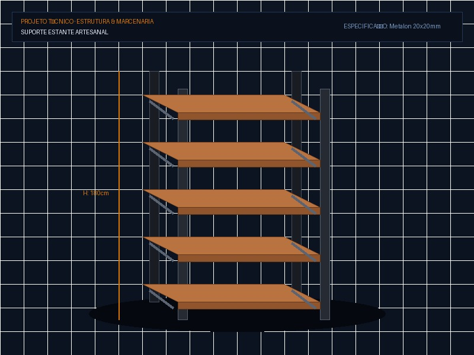
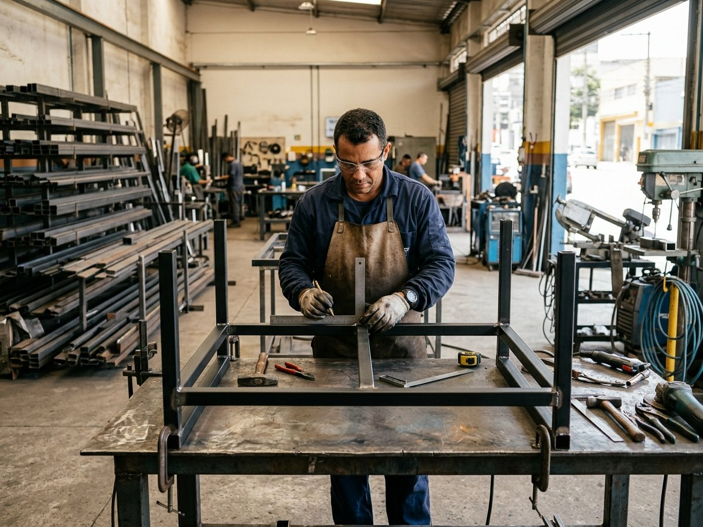

# ArtesEmFerro — Site Institucional e Catálogo

> Serralheria artística, peças sob medida e fabricação artesanal em ferro e aço.
> Site estático pronto para publicação via **GitHub Pages**.

---

## 📋 Visão Geral

Este repositório contém o site institucional e catálogo da **ArtesEmFerro**, desenvolvido em HTML5 semântico e CSS3 puro, sem dependências externas pesadas. O site inclui:

- **Página principal** (`index.html`) com hero, catálogo de 6 peças com tabelas de medidas, seção Sobre e contato.
- **Política de Uso e Encomendas** (`politica-de-uso.html`) com 8 seções detalhadas.
- **CSS modular** com variáveis CSS, Grid, Flexbox e responsividade completa (mobile, tablet, desktop).
- Todos os links de orçamento via **WhatsApp** e **e-mail** já configurados.
- Acessibilidade (atributos `aria-*`, `alt`, contraste WCAG AA, foco visível, `prefers-reduced-motion`).

---

## 📂 Estrutura de Pastas

```
ArtesEmFerro/
├── index.html                  # Página principal
├── politica-de-uso.html        # Política de Uso e Encomendas
├── README.md                   # Este arquivo
│
├── css/
│   └── styles.css              # Folha de estilos principal (CSS puro, variáveis, sem frameworks)
│
└── assets/
    ├── catalog/                # Fotos dos produtos do catálogo
    │   ├── suporte-estante.jpg         # Card 1 — Suporte Estante Artesanal
    │   ├── prateleira-suspensa.jpg     # Card 2 — Prateleira Suspensa em Aço
    │   ├── mesa-estrutura.jpg          # Card 3 — Mesa / Estrutura Sob Medida
    │   ├── grade-portao.jpg            # Card 4 — Grade / Portão Artístico
    │   ├── escada-corrimao.jpg         # Card 5 — Escada / Corrimão Industrial
    │   └── suporte-tv-painel.jpg       # Card 6 — Suporte Mural para TV / Painel
    │
    └── sobre-oficina.jpg       # Foto da oficina (seção Sobre)
```

---

## 🖼️ Como Adicionar / Substituir Imagens

### 1. Fotos do catálogo (cards de produto)

Cada card no `index.html` contém um bloco de placeholder com comentários indicando o caminho exato. Para substituir:

1. Coloque a foto na pasta `./assets/catalog/` com o nome exato indicado (ex.: `suporte-estante.jpg`).
2. No `index.html`, localize o card correspondente (busque pelo nome do arquivo nos comentários).
3. Substitua o bloco `<div class="card-image-placeholder">...</div>` por uma tag ``:

```html
<!-- ANTES (placeholder) -->
<div class="card-image-placeholder" aria-label="Aguardando foto: Suporte Estante Artesanal">
  ...
</div>

<!-- DEPOIS (com imagem real) -->

```

> **Dica:** Use `loading="lazy"` em todas as imagens fora da viewport inicial para melhor performance.
> **Recomendação de tamanho:** 800×600 px mínimo, formato `.jpg` ou `.webp`, qualidade 80–85%.

### 2. Foto da seção "Sobre" (oficina)

Coloque a foto em `./assets/sobre-oficina.jpg` e substitua no `index.html`:

```html
<!-- Localizar no bloco #sobre -->
<div class="sobre-img-placeholder">...</div>

<!-- Substituir por -->

```

### 3. Adicionar novos cards ao catálogo

Copie um `<article class="product-card">` existente no `index.html`, altere:
- `aria-label` do artigo
- `card-category`, `card-title`, `card-desc`
- Medidas na `measures-table`
- O texto da mensagem WhatsApp no `href` do botão (codificado em URL)
- O caminho da imagem

---

## 🚀 Como Publicar no GitHub Pages

### Pré-requisitos
- Git instalado (`git --version`)
- Acesso SSH configurado para GitHub (`ssh -T git@github.com`)

### Passo a passo

```bash
# 1. Entre na pasta do projeto
cd /home/devgege/Documentos/ArtesEmFerro

# 2. Inicialize o repositório Git local
git init

# 3. Adicione o repositório remoto
git remote add origin git@github.com:ArtesEmFerro/ArtesEmFerro.git

# 4. Adicione todos os arquivos ao stage
git add .

# 5. Faça o primeiro commit
git commit -m "feat: site institucional ArtesEmFerro — versão inicial"

# 6. Renomeie a branch para 'main' (se necessário)
git branch -M main

# 7. Envie para o GitHub
git push -u origin main
```

### Ativar o GitHub Pages

1. Acesse o repositório em [github.com/ArtesEmFerro/ArtesEmFerro](https://github.com/ArtesEmFerro/ArtesEmFerro)
2. Vá em **Settings** → **Pages** (menu lateral)
3. Em **Source**, selecione:
   - Branch: `main`
   - Folder: `/ (root)`
4. Clique em **Save**
5. Aguarde ~1–2 minutos e o site estará em:
   **`https://artesemferro.github.io/ArtesEmFerro/`**

> **Nota:** Se o repositório for da organização `ArtesEmFerro` e o nome for `ArtesEmFerro.github.io`, o site ficará em `https://artesemferro.github.io/`.

---

## 🎨 Customização Visual

### Paleta de cores (variáveis CSS em `css/styles.css`)

| Variável              | Valor       | Uso                          |
|-----------------------|-------------|------------------------------|
| `--color-iron`        | `#1a1a1e`   | Fundo escuro principal       |
| `--color-graphite`    | `#2c2c34`   | Cards e seções escuras       |
| `--color-copper`      | `#c8702a`   | Acento principal (cobre)     |
| `--color-copper-lt`   | `#e08944`   | Hover de botões e links      |
| `--color-ash`         | `#f0ede8`   | Fundo de seções claras       |
| `--color-white`       | `#fafaf8`   | Branco quente base           |

Para alterar a identidade de cor, edite as variáveis no bloco `:root` no início do `styles.css`.

### Tipografia

- **Títulos:** `Playfair Display` (Google Fonts)
- **Corpo:** `Inter` (Google Fonts)
- **Medidas/Código:** `JetBrains Mono` (Google Fonts)

---

## 📞 Contato da Loja

| Canal     | Informação                        |
|-----------|-----------------------------------|
| WhatsApp  | (14) 99827-8402                   |
| E-mail    | geovaneparedes02@gmail.com        |

---

## 📄 Licença

© 2026 ArtesEmFerro. Todos os direitos reservados.
O código-fonte pode ser usado como referência para outros projetos, mas o conteúdo textual,
fotografias e identidade visual são exclusivos da ArtesEmFerro.
Consulte [politica-de-uso.html](./politica-de-uso.html) para os termos completos.
